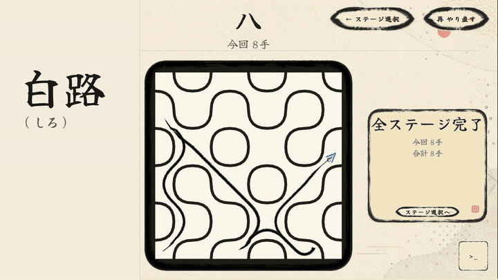

# 白路（しろ）

白紙に隠された道路を覗き、記憶し、タイルを回して旅路をつなぐパズルゲームです。

[](https://unityroom.com/games/sakakupuzzle)
[](https://github.com/The-fthe/sakaku-puzzle-public/raw/refs/heads/main/docs/media/shiro-portfolio.webm)

## 紹介動画

[](https://github.com/The-fthe/sakaku-puzzle-public/raw/refs/heads/main/docs/media/shiro-portfolio.webm)

## 操作

| キー | 動作 |
| --- | --- |
| `R` | やり直す |
| `Esc` | ステージ選択へ戻る |
| `H` | 解法を 1 手進める（検証用。使ったプレイはランキング対象外） |
| `C` | 自動でクリアする（検証用。使ったプレイはランキング対象外） |
| `N` | 新しい問題を作る（検証用） |
| `D` | デバッグ表示を切り替える（エディターと開発ビルドのみ） |

## 動かし方

Unity 6000.5.3f1 でこのフォルダーを開き、`Assets/Scenes/StageSelect.unity` を再生します。

## コードの構成

```text
Assets/Scripts/
  Game/         ゲーム画面の進行（PuzzleSceneController）
  Puzzle/       問題の生成、道のつながりの判定、最短手順の探索、ステージの進行
  Board/        盤面・タイル・道の見せ方・目的地
  Traveler/     旅人・筆跡・旅人が通る曲線の計算
  StageSelect/  ステージ選択画面
  UI/           ボタン・HUD・カーソル・画面遷移
  Panels/       遊び方・結果・デバッグ表示
  Audio/        BGM・効果音
  Services/     unityroom へのスコア送信
  Settings/     UI カタログ・テーマ・レイアウト・動きの設定
Assets/Editor/  ビルド
Assets/Tests/   EditMode テスト（Scripts と同じ分け方）
```

## 音源について

音源は著作権の都合で同梱していません。
入手先：`Assets/Resources/Audio/Bgm/README.md`、`Assets/GameAssets/Audio/README.md`

## クレジット

- ゲーム制作の着想・参考：[知覚のアルケオロジー](https://x.com/shudankaineko)
- フォント：Yuji Syuku、Noto Sans JP（SIL Open Font License。`Assets/GameAssets/Fonts/` を参照）
